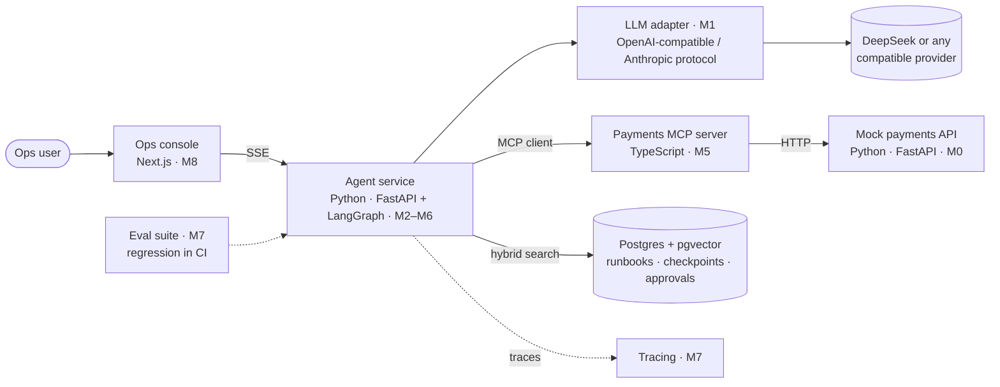

# PayOps Agent

An AI agent that helps payment operations teams investigate stuck payouts — and never moves money without a human approving it.

> **Status:** early development. Milestone 0 (mock payments API) and Milestone 1 (LLM basics) are in progress. See the [roadmap](#roadmap).

## The problem

"Why hasn't payout X arrived?" is the most common ticket a payments operations team handles. Answering it means checking the transfer's state machine, the banking partner's view of the payment, webhook delivery logs, reconciliation records and the team's runbooks — and then, sometimes, taking an action that moves money (retrying a payout) or touches a merchant's systems (resending a webhook).

The investigation part is a good fit for an LLM agent. The action part is where agents are dangerous: a payout retried after a timeout, when the partner had in fact already paid it, is a double payout.

PayOps Agent builds such an agent end to end, with the safety properties a payments system needs:

- **Answers with evidence.** Every claim cites a tool result or a runbook section.
- **Two-phase actions.** Tools that move money only *propose* an action; it executes after a human approves it.
- **Deterministic idempotency keys.** An approved action executes at most once, even when the agent graph is resumed or a request is retried.
- **Fail closed.** If the agent cannot confirm an action is safe (for example, the partner's status API is down), it does not act.
- **Defense in depth.** The payments API re-checks every rule server-side; the agent is never the only guard.
- **Tool output is data, not instructions.** Content controlled by merchants or partners (webhook response bodies, payment references) is treated as untrusted input.

## Target behaviour

> **Ops:** Why is `tr_…` stuck? The merchant says their supplier hasn't been paid.
>
> **Agent:** The transfer failed on our side with `partner_timeout` (status history, 09:12 UTC), but the banking partner reports the payment as **paid** (partner lookup), and yesterday's statement has a matching debit flagged `status_mismatch` (reconciliation). Retrying would pay the supplier twice. Per runbook *Payout timeouts §3*, escalate to reconciliation to correct the status; once it is fixed, resend the `transfer.completed` webhook.
>
> **Proposed action:** none — retry is blocked.

## Architecture



The mock payments API stands in for the real systems an ops team would query. It has a transfer state machine, quotes, virtual accounts and deposits, webhook deliveries, a banking-partner view and reconciliation records, seeded with deterministic synthetic data and a frozen clock so that investigations and evals are reproducible. Until Milestone 5, the agent calls it over plain HTTP; from Milestone 5 on, through the MCP server.

## Roadmap

Each milestone ships something runnable, a plan in [`docs/plans/`](docs/plans/) and a learning note (in Chinese) in [`docs/learn/`](docs/learn/).

| # | Milestone | Demo | Status |
|---|-----------|------|--------|
| 0 | Mock payments API and synthetic scenarios | Browse transfers, partner status and webhook logs at `/docs` | 🚧 |
| 1 | LLM API basics: prompts, structured output, streaming, provider adapter | `payops triage` and `payops explain --stream` | 🚧 |
| 2 | Tool calling with a hand-written agent loop | Ask why a payout is stuck; watch the tool calls | ⏳ |
| 3 | RAG over runbooks: pgvector + BM25 hybrid search, reranking, citations | Answers cite runbook sections | ⏳ |
| 4 | LangGraph rewrite with checkpoints and multi-turn memory | Same agent as a state graph; compare with M2 | ⏳ |
| 5 | Payments MCP server (TypeScript, stdio + Streamable HTTP) | Use the tools from Claude Desktop or Cursor | ⏳ |
| 6 | Safety: two-phase actions, idempotency, interrupt/resume, prompt-injection and ID-scope defenses | Approve a retry; see an injected instruction ignored | ⏳ |
| 7 | Evals and observability: labeled cases, deterministic checks + LLM-as-judge, CI regression, tracing | Accuracy, TTFT, P95 latency and cost per task in this README | ⏳ |
| 8 | Productization: FastAPI + SSE, Next.js console, Docker deployment | Public demo and walkthrough video | ⏳ |

## Repository layout

```text
services/
  mock-pay/       Mock payments API (M0)
  agent/          Agent service and LLM adapter (M1+)
docs/
  learn/          Learning notes, one per milestone (Chinese)
  plans/          Implementation plan written before each milestone
  ai-dev-log.md   Mistakes the AI made, how they were caught and fixed
evals/            Ground-truth scenario labels (never shown to the agent)
```

## Quickstart

Requires [uv](https://docs.astral.sh/uv/) and GNU Make.

```bash
make setup     # install the Python workspace
make check     # lint, type-check and test everything
```

## How this project is built

The project is developed with an AI coding agent (Claude Code), and the workflow is part of what it demonstrates:

- **Plan before code.** Each milestone starts with a written plan in [`docs/plans/`](docs/plans/).
- **Tests first** for domain rules, then implementation; every PR passes lint, strict type checks and tests in CI.
- **Small PRs** with commit messages that say what changed and why.
- **Honest record.** [`docs/ai-dev-log.md`](docs/ai-dev-log.md) logs the mistakes the AI made, how they were detected and how they were fixed.
- **Explicit rules for the agent** in [`CLAUDE.md`](CLAUDE.md): no real data, no secrets in the repo, verify before claiming done.

## Data

Everything in this repository is synthetic. Merchant names (Northwind, Tailspin, Wingtip, Fourth Coffee, Fabrikam) are well-known fictional placeholders; banking partners are named `bank_alpha`, `bank_beta` and `bank_gamma`. No real company, partner, customer or transaction data is used.

## License

[MIT](LICENSE)
